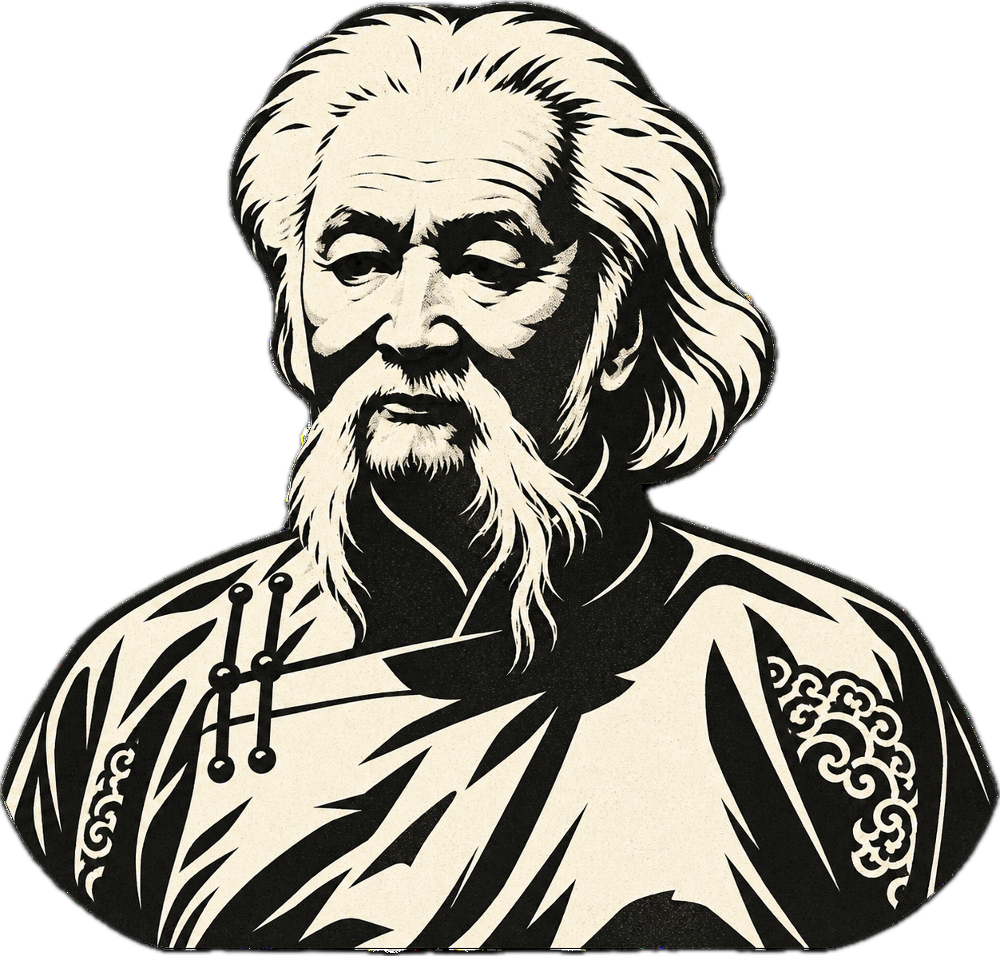

<a id="readme-top"></a>

<div align="center">
  <a href="https://github.com/btseee/rinchen">
    
  </a>

  <h3 align="center">Rinchen</h3>

  <p align="center">
    Open-source, Mongolian-centric machine translation trained from scratch.
    <br />
    Context-aware translations, fast inference, and CPU-friendly deployment.
  </p>
</div>

<details>
  <summary>Table of Contents</summary>
  <ol>
    <li><a href="#about">About</a></li>
    <li><a href="#status">Status</a></li>
    <li><a href="#features">Features</a></li>
    <li><a href="#supported-languages">Supported languages</a></li>
    <li><a href="#getting-started">Getting started</a></li>
    <li><a href="#usage">Usage</a></li>
    <li><a href="#documentation">Documentation</a></li>
    <li><a href="#project-layout">Project layout</a></li>
    <li><a href="#development">Development</a></li>
    <li><a href="#community">Community</a></li>
    <li><a href="#license">License</a></li>
  </ol>
</details>

## About

Rinchen is an open-source machine translation project with Mongolian (Khalkha, Cyrillic script) as its central language. Every model is trained from random initialisation with Eole, exported to CTranslate2 for fast CPU inference, and served through a command line, a Python API and an HTTP service. External pretrained models are used only as evaluation baselines or to generate synthetic training text.

The project is named after Byamba Rinchen, a Mongolian writer, linguist, translator and scholar ([Byamba Rinchen on Wikipedia](https://de.wikipedia.org/wiki/Bjambyn_Rintschen)).

## Status

Rinchen is pre-release: no real model, no real corpus and no released artifact exist yet. The machinery of every milestone, D0 to D15, is built and was measured on toy data only: templated fixture sentences that a tiny model memorises, so every number the project records is a toy number and ranks nothing. No GPU was used: every measurement ran on the CPU.

The current state and the open gates are on the Wiki pages [State](https://github.com/btseee/rinchen/wiki/State) and [Roadmap](https://github.com/btseee/rinchen/wiki/Roadmap).

## Features

What the code does today, as commands of the `rinchen` program:

- Data acquisition from OPUS, Hugging Face datasets, WARC files and Common Crawl into `data/raw/`, with resumable downloads and checksums (`rinchen data`).
- Text normalisation and SentencePiece tokenizers whose user-defined symbols are the reserved symbols and the direction tags of the registry (`rinchen spm`).
- Filtering and mining of parallel text: script ratio, numbers, length, language identification, MinHash deduplication, LaBSE and quality-estimation scores, and sentence and document alignment (`rinchen filter`, `rinchen mine`).
- A Cyrillic to traditional Mongolian script converter: a rule baseline and a small character model (`rinchen convert-script`).
- Synthetic data through an OpenAI-compatible chat completions server, such as vLLM or llama.cpp (`rinchen synth`).
- Training with Eole from random initialisation: multilingual ablations, teacher runs with resume and checkpoint averaging, document-level continuation and distillation into smaller students (`rinchen train`, `rinchen distill`).
- Export to CTranslate2 in float32, float16, int8 and int8_float16, with a parity check against Eole (`rinchen export`).
- Translation with an export: `rinchen translate`, the Python class `rinchen.Translator` and the HTTP service `rinchen serve`, with a script mask that keeps the output in the target's script.
- Evaluation: BLEU, chrF and chrF++ with 95 % bootstrap intervals and paired comparisons, robustness measures for numbers, placeholders, names, glossary terms and script purity, and a report in JSON and Markdown (`rinchen eval`). Neural metrics such as COMET-22 and MetricX-24 are not computed: the evaluation seam accepts score files for them.
- Release staging with a model card and an upload plan for the Hugging Face Hub, a dry run unless asked (`rinchen release`).
- A maintenance check of the package stack against the lock file (`rinchen maintain`), a human annotation tool for test sets (`rinchen annotate`), the environment checks (`rinchen doctor`) and an end-to-end tiny pipeline on the CPU (`rinchen tiny`).

## Supported languages

The language registry, `configs/languages.yaml`, holds ten languages. A model is told the language to write by a direction tag.

| Language | Code | Direction tag |
| --- | --- | --- |
| Mongolian (Khalkha), Cyrillic script | `khk_Cyrl` | `<2khk_Cyrl>` |
| Mongolian, traditional script | `mn_Mong` | `<2mn_Mong>` |
| English | `eng_Latn` | `<2eng_Latn>` |
| Russian | `rus_Cyrl` | `<2rus_Cyrl>` |
| Chinese (Simplified) | `zho_Hans` | `<2zho_Hans>` |
| Korean | `kor_Hang` | `<2kor_Hang>` |
| Japanese | `jpn_Jpan` | `<2jpn_Jpan>` |
| German | `deu_Latn` | `<2deu_Latn>` |
| Kazakh | `kaz_Cyrl` | `<2kaz_Cyrl>` |
| Turkish | `tur_Latn` | `<2tur_Latn>` |

## Getting started

### Requirements

- CPython 3.14 (no other version is accepted)
- [uv](https://docs.astral.sh/uv/)
- [just](https://just.systems/), for the recipes of the `justfile`
- Linux or Windows: the lock file is resolved for those two platforms

No GPU is needed: everything runs on the CPU.

### Install

```bash
git clone https://github.com/btseee/rinchen.git
cd rinchen
uv sync --frozen --group dev
```

`--frozen` installs exactly what `uv.lock` says. This is the command CI runs.

### Check the environment

```bash
uv run --frozen --no-sync rinchen doctor
```

The doctor prints one line per check (`[OK]`, `[FAIL]` or `[SKIP]`) and exits 1 when a check fails. On a machine without a GPU the CUDA check is a skip, which is the expected result.

### Run the tiny pipeline

```bash
just tiny
```

The recipe runs `rinchen tiny run --profile tiny`: fifteen stages from committed fixture files to a trained, exported and evaluated toy model, on the CPU and with no network. It writes `report.json`, `report.md` and `manifest.json` under `artifacts/tiny/` and exits 0 when all eight thresholds pass.

## Usage

The examples translate with an export directory, `EXPORT_DIR`, that `rinchen export convert` wrote. Only toy exports exist so far.

### Command line

```bash
uv run --frozen --no-sync rinchen translate --model EXPORT_DIR --src eng_Latn --tgt khk_Cyrl --input INPUT.txt --output OUTPUT.txt
```

The input is UTF-8 text with one text per line, and the output has exactly one line per input line. `--script Mong` asks for the traditional script on a Mongolian target, and `rinchen translate --help` lists every option.

### Python

```python
import rinchen

with rinchen.Translator("EXPORT_DIR", device="cpu") as translator:
    result = translator.translate(
        "the cat sat on the mat", tgt="khk_Cyrl", src="eng_Latn"
    )
    print(result.text, result.status)
```

The signatures are `Translator(directory, *, device="cpu", compute_type="default", inter_threads=1, intra_threads=1, script_converter=None)` and `translate(texts, *, tgt, src=None, script=None, beam_size=4, n=1, max_decoding_length=256, max_source_pieces=256, script_mask="retry")`. A string gives one `Translation` and a list of strings gives a list.

### HTTP service

```bash
uv run --frozen --no-sync rinchen serve --model EXPORT_DIR --config configs/serve/tiny.yaml
```

The service listens on `127.0.0.1:8000` by default and has no authentication.

| Route | Methods | Answer |
| --- | --- | --- |
| `/v1/translate` | POST | the translations of the texts of one request |
| `/healthz` | GET, HEAD | 200 while the process runs |
| `/readyz` | GET, HEAD | 200 once the model is loaded, 503 before and while stopping |
| `/metrics` | GET, HEAD | Prometheus metrics |

```bash
curl -s -X POST http://127.0.0.1:8000/v1/translate \
  -H "Content-Type: application/json" \
  -d '{"texts": ["the cat sat on the mat"], "src": "eng_Latn", "tgt": "khk_Cyrl"}'
```

## Documentation

The documentation lives on the [project Wiki](https://github.com/btseee/rinchen/wiki).

| Page | What it covers |
| --- | --- |
| [Getting Started](https://github.com/btseee/rinchen/wiki/Getting-Started) | requirements, installation, the doctor, the tiny pipeline and the gate |
| [Architecture](https://github.com/btseee/rinchen/wiki/Architecture) | the package map, the data flow and the design rules |
| [CLI Reference](https://github.com/btseee/rinchen/wiki/CLI-Reference) | every `rinchen` command with its help text |
| [Configuration](https://github.com/btseee/rinchen/wiki/Configuration) | every file under `configs/` and the environment variables |
| [Data Policy](https://github.com/btseee/rinchen/wiki/Data-Policy) | the data rules, the acquisition tools and the human test sets |
| [Training Pipeline](https://github.com/btseee/rinchen/wiki/Training-Pipeline) | a model from data to export |
| [Evaluation and Release](https://github.com/btseee/rinchen/wiki/Evaluation-and-Release) | metrics, suites, robustness, the report, the model card and the release tools |
| [Serving](https://github.com/btseee/rinchen/wiki/Serving) | the HTTP service, `rinchen.Translator` and `rinchen translate` |
| [Testing and Gates](https://github.com/btseee/rinchen/wiki/Testing-and-Gates) | the test layout, the markers, the fixtures and the gate |
| [CI and Workflows](https://github.com/btseee/rinchen/wiki/CI-and-Workflows) | the three GitHub workflows |
| [Maintenance](https://github.com/btseee/rinchen/wiki/Maintenance) | the maintenance check, upgrades and rollback |
| [Troubleshooting](https://github.com/btseee/rinchen/wiki/Troubleshooting) | failures, their causes and their remedies |
| [Glossary](https://github.com/btseee/rinchen/wiki/Glossary) | the terms of the code and the documents |
| [Roadmap](https://github.com/btseee/rinchen/wiki/Roadmap) | the milestones and the open gates |
| [Contributing](https://github.com/btseee/rinchen/wiki/Contributing) | the development loop and the conventions |
| [State](https://github.com/btseee/rinchen/wiki/State) | the current state of the project and the open gates |
| [Stack](https://github.com/btseee/rinchen/wiki/Stack) and [Verification Log](https://github.com/btseee/rinchen/wiki/Verification-Log) | the package versions and the upstream facts checked against them |

The Wiki also has one runbook per operator stage, from [Runbook 00: environment](https://github.com/btseee/rinchen/wiki/Runbook-00-Environment) to [Runbook 15: tiny pipeline](https://github.com/btseee/rinchen/wiki/Runbook-15-Tiny-Pipeline).

## Project layout

- `src/rinchen/`: the Python package, one subpackage per feature (`acquire`, `spm`, `filter`, `mine`, `script_conv`, `synth`, `train`, `export`, `infer`, `serve`, `eval`, `maintain`, `tiny` and others) and the command line in `cli/`
- `configs/`: the language registry, the profiles and the configurations of every stage
- `tests/`: unit, property, golden and integration tests, with their fixtures and support modules
- `scripts/`: the generators of the committed fixtures, the environment probe and the Wiki checker
- `docker/`: the CPU image of the HTTP service and its compose file (never built)
- `vendor/`: the wheels that have no CPython 3.14 release upstream
- `manifests/` and `reports/`: recorded package versions, build records and the environment probe's report (`plans/` is an empty placeholder)
- `data/`: local data, ignored by git
- `.github/`: the workflows, the community files and the issue forms

## Development

Run the full local gate, the same checks CI runs:

```bash
just gate
```

It runs `ruff format --check .`, `ruff check .`, `mypy src` and `pytest -m "not network" -q`. CI also runs `just tiny`.

The project's rules are short: CPython 3.14 only, tests before code, numeric thresholds are gates, every model is trained from random initialisation, and the state is kept on the Wiki page State, in the committed configs and in `manifests/`. The [contributing guide](.github/CONTRIBUTING.md) and the Wiki page [Contributing](https://github.com/btseee/rinchen/wiki/Contributing) give the setup, the conventions and how to open a pull request.

## Community

- [Code of conduct](.github/CODE_OF_CONDUCT.md): how we treat each other.
- [Contributing guide](.github/CONTRIBUTING.md): setup, tests, commits and pull requests.
- [Security policy](.github/SECURITY.md): how to report a vulnerability in private.
- [Accessibility statement](ACCESSIBILITY.md): what the project does, its limits, and how to report a barrier.
- [Project Wiki](https://github.com/btseee/rinchen/wiki): the long-form documentation.

To report a bug, ask for a feature, or report a documentation or accessibility problem, open an issue and choose a form.

## License

Specify the project license here.

<p align="right">(<a href="#readme-top">back to top</a>)</p>